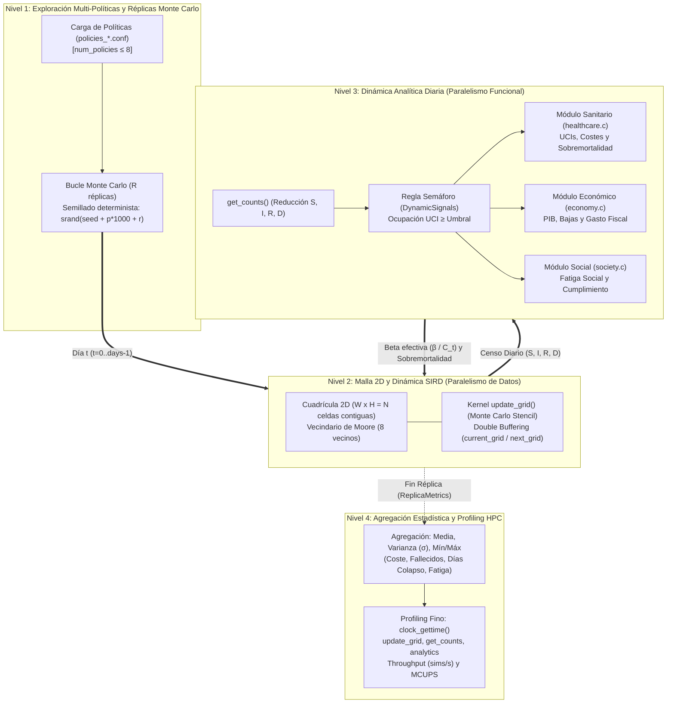
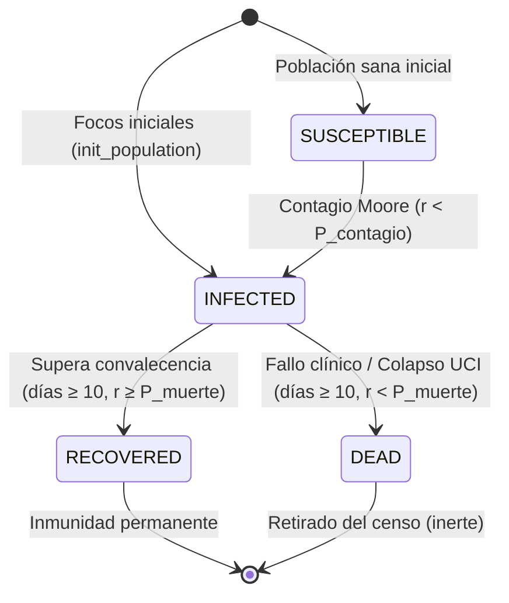
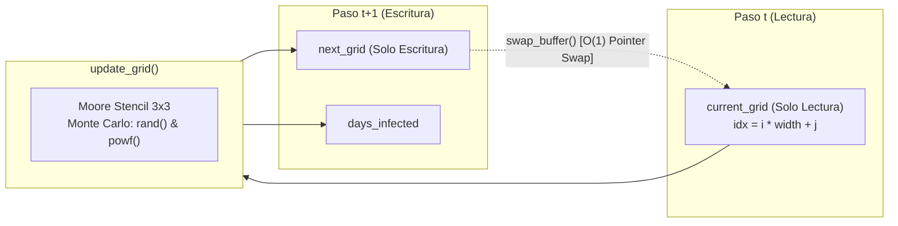

# Modelo Matemático y Algorítmico de PandemicSim

Este documento describe en profundidad el modelo epidemiológico, socioeconómico, estadístico y computacional implementado en **PandemicSim** para la **Práctica 2** de *Ingeniería de los Computadores*.

---

## 1. Visión General del Sistema y Arquitectura de Ejecución

**PandemicSim** es un simulador epidemiológico y macroeconómico de alto rendimiento implementado en **C11**, estructurado en una jerarquía computacional de tres niveles desacoplados:

1. **Nivel Micro (Dinámica Epidemiológica Celular):** Un autómata celular estocástico bidimensional con vecindario de Moore y técnica de *Double Buffering* ($\mathcal{O}(1)$ pointer swap) que modela el contacto físico y la transmisión vírica entre individuos.
2. **Nivel Macro (Evaluación de Impacto y Políticas de Intervención):** Módulos analíticos que computan el impacto en el sistema sanitario (saturación y colapso de camas de planta y UCI), el impacto socioeconómico (pérdidas del PIB, costes de bajas y subsidios estatales) y la adherencia ciudadana (fatiga social).
3. **Nivel Estadístico y de Rendimiento (Monte Carlo y Profiling HPC):** Exploración multipolítica con réplicas estocásticas Monte Carlo independientes ($R$ réplicas) para calcular media y dispersión ($\mu \pm \sigma$), junto con instrumentación temporal de alta resolución para medir productividad macro (simulaciones/s) y rendimiento del kernel (MCUPS).



---

## 2. Dinámica Epidemiológica: Estados, Parámetros y Autómata Celular

La población se discretiza espacialmente en una cuadrícula bidimensional regular de tamaño $H \times W = N$. Cada celda representa un individuo ubicado en coordenadas discretas $(i, j)$.

### 2.1. Modelo Compartimental SIRD

A diferencia del modelo SIR clásico (Kermack y McKendrick, 1927), **PandemicSim** segrega a los individuos que abandonan la infección en **Recuperados** e **Inmunizados** frente a **Fallecidos**, cuantificando con precisión el coste en vidas humanas y la sobremortalidad inducida por el colapso de las Unidades de Cuidados Intensivos (UCI):

| Estado | Código en C | Definición Epidemiológica | Comportamiento en la Simulación |
| :--- | :---: | :--- | :--- |
| **`SUSCEPTIBLE`** | `0` | Individuo sano sin inmunidad previa. | Puede infectarse por interacción con vecinos infectados en su vecindario de Moore. |
| **`INFECTED`** | `1` | Individuo enfermo activo y contagioso. | Propaga el patógeno a celdas contiguas; consume recursos hospitalarios y genera bajas laborales. Registra `days_infected`. |
| **`RECOVERED`** | `2` | Individuo que ha superado el ciclo vírico. | Adquiere **inmunidad permanente** tras 10 días de convalecencia. No vuelve a transmitir ni a contagiarse. |
| **`DEAD`** | `3` | Individuo fallecido a causa de la patología o colapso sanitario. | Celda inerte que cesa toda interacción epidemiológica y socioeconómica en la malla. |

#### Constantes Clínicas Base (`include/policy.h`)
* **Período de Convalecencia Crítica (`RECOVERY_DAYS`):** $10$ días.
* **Tasa de Mortalidad Clínica Base (`BASE_DEATH_RATE`):** $0.02$ ($2.0\%$ de letalidad en condiciones de atención sanitaria óptima sin saturación).

---

### 2.2. Parámetros de Transmisión: Tasa $\beta$, Semáforo Reactivo y $\beta_{\text{efectivo}}$

* **Tasa de Transmisión por Contacto ($\beta$):** Probabilidad diaria de que un infectado transmita el patógeno a un vecino susceptible en contacto directo:
  $$\beta \in [0.0, 1.0]$$
* **Regulación Dinámica ("Semáforo Reactivo" / `DynamicSignals`):**
  Las políticas pueden definir un umbral de saturación de UCIs (`dynamic_ICU_threshold`). Al inicio de cada día $t$, se evalúa la ocupación del sistema de cuidados intensivos respecto a la capacidad instalada:
  $$\text{ocupación\_UCI}_t = \frac{\text{Demanda}_{\text{UCI}}}{\text{Capacidad}_{\text{UCI}}} = \frac{\lceil I_t \times 0.05 \rceil}{\lfloor N \times 0.005 \rfloor} \approx \frac{I_t}{N \times 0.10}$$
  
  $$\beta_t = \begin{cases} 0.08, & \text{si } \text{ocupación\_UCI}_t \ge \text{dynamic\_ICU\_threshold} \\ \beta_{\text{base}}, & \text{en caso contrario} \end{cases}$$
  $$\text{trade\_restriction}_t = \begin{cases} 0.50, & \text{si } \text{ocupación\_UCI}_t \ge \text{dynamic\_ICU\_threshold} \\ \text{base\_restriction}, & \text{en caso contrario} \end{cases}$$
  Este mecanismo emula el endurecimiento automático de restricciones sanitarias (confinamientos perimetrales, cese de comercio no esencial) ante riesgo inminente de colapso hospitalario.

* **Tasa de Transmisión Efectiva ($\beta_{\text{efectivo}}$):**
  En presencia de restricciones continuadas, la población sufre fatiga social, reduciendo el factor de cumplimiento ciudadano $C_t \in [0.40, 1.0]$. La tasa de contagio diaria real se modula mediante:
  $$\beta_{\text{efectivo}} = \frac{\beta_t}{C_t}$$
  A menor cumplimiento normativo, mayor es la tasa de contacto y propagación efectiva del virus ($\beta / 0.50 = 2\beta$).

---

### 2.3. Diagrama de Transición de Estados



#### Tabla Formal de Transiciones y Condiciones de Guarda
En cada ciclo diario ($t \to t+1$), cada celda de la cuadrícula evalúa su transición de acuerdo con la siguiente matriz de reglas estocásticas:

| Estado Actual $S(t)$ | Condición de Disparo (Guarda) | Siguiente Estado $S(t+1)$ | Probabilidad $P(S(t+1) \mid S(t))$ | Efecto / Actualización Interna |
| :--- | :--- | :---: | :---: | :--- |
| **`SUSCEPTIBLE`** | Al menos 1 vecino infectado y $r < P(\text{contagio})$ | **`INFECTED`** | $1 - (1 - \beta_{\text{efectivo}})^k$ | Pasa a infectado; `days_infected = 1` |
| **`SUSCEPTIBLE`** | $k = 0$ vecinos infectados o $r \ge P(\text{contagio})$ | **`SUSCEPTIBLE`** | $(1 - \beta_{\text{efectivo}})^k$ | Permanece sano sin cambios |
| **`INFECTED`** | Periodo de convalecencia en curso ($\text{días} < 10$) | **`INFECTED`** | $1.0$ (Determinista) | Incrementa estancia: `days_infected++` |
| **`INFECTED`** | Fin de convalecencia ($\text{días} \ge 10$) y $r \ge P(\text{muerte})$ | **`RECOVERED`** | $1 - (\text{BASE\_DEATH\_RATE} \times f_{\text{sobremortalidad}})$ | Supera la infección y adquiere inmunidad permanente |
| **`INFECTED`** | Fin de convalecencia ($\text{días} \ge 10$) y $r < P(\text{muerte})$ | **`DEAD`** | $\text{BASE\_DEATH\_RATE} \times f_{\text{sobremortalidad}}$ | Fallece por gravedad o colapso de UCI |
| **`RECOVERED`** | Inmunidad permanente adquirida | **`RECOVERED`** | $1.0$ (Estado absorbente) | Celda inmune inerte frente a nuevos contagios |
| **`DEAD`** | Cese vital | **`DEAD`** | $1.0$ (Estado absorbente) | Celda inerte retirada del censo activo |


---

### 2.4. Topología Espacial: Malla Cuadrada y Vecindario de Moore

La simulación adapta la población total solicitada $N$ a una malla cuadrada 2D regular:
$$W = \lfloor \sqrt{N} \rfloor, \quad H = W, \quad N_{\text{real}} = H \times W$$

Cada celda $(i, j)$ interactúa exclusivamente con sus **8 vecinos inmediatos** (distancia de Chebyshev $D_\infty = 1$):

```text
       ┌──────────────┬──────────────┬──────────────┐
       │  (i-1, j-1)  │   (i-1, j)   │  (i-1, j+1)  │
       ├──────────────┼──────────────┼──────────────┤
       │   (i, j-1)   │  CELDA (i,j) │   (i, j+1)   │
       ├──────────────┼──────────────┼──────────────┤
       │  (i+1, j-1)  │   (i+1, j)   │  (i+1, j+1)  │
       └──────────────┴──────────────┴──────────────┘
```

**Condiciones de contorno:** No periódicas (fronteras cerradas). Para celdas en los bordes ($i \in \{0, H-1\}$ o $j \in \{0, W-1\}$), las comprobaciones de rango descartan índices fuera de malla:
$$(ni \ge 0 \land ni < H \land nj \ge 0 \land nj < W)$$

---

### 2.5. Formulación Estocástica del Contagio

Para una celda en estado `SUSCEPTIBLE`, el número de vecinos infectados activos $k$ se calcula mediante el stencil 2D:
$$k = \sum_{\delta_i = -1}^{1} \sum_{\delta_j = -1}^{1} \mathbb{I}\left(\text{grid}[i+\delta_i, j+\delta_j] == \text{INFECTED}\right) \quad \text{con } (\delta_i, \delta_j) \neq (0,0)$$

1. **Probabilidad de no contagio por un vecino infectado:** $1 - \beta_{\text{efectivo}}$
2. **Probabilidad de no contraer el virus de ninguno de los $k$ vecinos infectados:**
   $$P(\text{no contagio}) = (1 - \beta_{\text{efectivo}})^k$$
3. **Probabilidad de contagio (suceso complementario):**
   $$P(\text{contagio}) = 1 - (1 - \beta_{\text{efectivo}})^k$$

#### Muestreo Monte Carlo
La CPU genera un número pseudoaleatorio uniforme $r = \frac{\text{rand()}}{\text{RAND\_MAX}} \in [0, 1)$:
$$\text{next\_grid}[idx] = \begin{cases} \text{INFECTED} \quad (\text{y } \text{days\_infected}[idx] \leftarrow 1), & \text{si } r < P(\text{contagio}) \\ \text{SUSCEPTIBLE}, & \text{en caso contrario} \end{cases}$$

---

### 2.6. Proceso de Convalecencia y Sobremortalidad

Para una celda en estado `INFECTED`:
1. Se incrementa su estancia clínica: $\text{days\_infected}[idx] \leftarrow \text{days\_infected}[idx] + 1$.
2. **Evaluación de desenlace clínico:** Solo cuando $\text{days\_infected}[idx] \ge \text{RECOVERY\_DAYS}$ ($10$ días):
   $$P(\text{muerte}) = \text{BASE\_DEATH\_RATE} \times f_{\text{sobremortalidad}}$$
   *(Donde $\text{BASE\_DEATH\_RATE} = 0.02$ y $f_{\text{sobremortalidad}} \ge 1.0$ proviene del módulo sanitario).*
3. **Muestreo Monte Carlo:**
   $$\text{next\_grid}[idx] = \begin{cases} \text{DEAD}, & \text{si } r < P(\text{muerte}) \\ \text{RECOVERED}, & \text{si } r \ge P(\text{muerte}) \end{cases}$$
4. Si $\text{days\_infected}[idx] < 10$, el individuo permanece en estado `INFECTED`.

---

## 3. Arquitectura de Memoria, Doble Búfer y Análisis de Vectorización

### 3.1. Estructura de Datos en Heap y Doble Búfer (`simulator.h`)

La malla se modela mediante la estructura `Grid`:
```c
typedef struct {
    int height;          // Filas de la cuadrícula
    int width;           // Columnas de la cuadrícula
    int *current_grid;   // Búfer de lectura en el paso t (tamaño height * width)
    int *next_grid;      // Búfer de escritura en el paso t+1 (tamaño height * width)
    int *days_infected;  // Días de infección acumulados por cada celda
} Grid;
```



* **Disposición Lineal Contigua (*Row-Major*):** El mapeo bidimensional se linealiza como:
  $$\text{idx} = i \times \text{width} + j$$
* **Localidad Espacial de Caché (*Stride = 1*):** El orden de iteración exterior por filas (`i`) e interior por columnas (`j`) asegura que cada línea de caché L1/L2 (64 bytes) cargada desde la memoria principal albergue 16 celdas contiguas de tipo `int`, minimizando los fallos de caché (*cache misses*).
* **Intercambio en Tiempo $\mathcal{O}(1)$ (`swap_buffer`):** El avance de día se efectúa intercambiando los punteros `current_grid` y `next_grid` en $\mathcal{O}(1)$, sin copias de datos en memoria.

---

### 3.2. Marcadores Ensamblador (`__asm__`) y Diagnóstico de Autovectorización

Para facilitar la inspección con `make asm` y correlacionar el código C con las instrucciones máquina generadas, el código incorpora etiquetas ensamblador directas:

* **Kernel `update_grid` (`src/simulator.c`):**
  ```c
  __asm__ volatile("# [update_grid] BEGIN: outer row loop (i = 0..height)");
  __asm__ volatile("# VECTORIZATION TARGET: inner j-loop over current_grid[] (stride-1, row-major)");
  __asm__ volatile("# BARRIER: rand() call and powf() prevent auto-vectorization at -O3");
  ```
  > [!NOTE] Diagnóstico de Compilación GCC (`-fopt-info-vec-all`)
  > En `update_grid`, a pesar de que el acceso a memoria presenta *stride-1*, GCC reporta: `statement clobbers memory` y `not vectorized: control flow in loop`. Las llamadas dependientes del estado a funciones de la biblioteca estándar (`rand()` y `powf()`) dentro de bifurcaciones condicionales actúan como **barreras de autovectorización**, forzando la generación de código escalar para el bucle de actualización celular.

* **Kernel `get_counts` (`src/simulator.c`):**
  ```c
  __asm__ volatile("# [get_counts] BEGIN: reduction loop (idx = 0..total_cells)");
  __asm__ volatile("# VECTORIZATION TARGET: simple switch/accumulator, no side effects");
  ```
  Bucle de reducción unidimensional sobre `current_grid[]`. El flujo de control mediante sentencia `switch/case` con incrementos acumulativos escalares limita la vectorización automática tradicional de bucles sin reestructuración SIMD previa.

* **Optimización SLP en `swap_buffer` y `compute_policy_stats`:**
  El compilador vectoriza con éxito bloques básicos mediante **SLP (*Superword-Level Parallelism*)**:
  - En `swap_buffer`, el intercambio de dos punteros de 64 bits (`current_grid` y `next_grid`) se vectoriza empleando instrucciones vectoriales de 32 bytes (`VEC_PERM_EXPR`).
  - En `compute_policy_stats`, la inicialización simultánea de `min_deaths` y `max_deaths` y el cálculo de promedios de profiling se vectorizan con registros empaquetados AVX2.

---

## 4. Módulos Analíticos de Impacto Socioeconómico

Al inicio de cada día de simulación, la función `get_counts` cuantifica el censo epidemiológico global $(S_t, I_t, R_t, D_t)$ y alimenta a los tres submódulos analíticos:

### 4.1. Módulo Sanitario (`src/healthcare.c`)
Modela la saturación de los recursos hospitalarios, la sobremortalidad inducida por colapso y el gasto asistencial directo:

1. **Demanda hospitalaria diaria:**
   $$\text{Demanda}_{\text{UCI}} = \lceil I_t \times 0.05 \rceil \quad (5\% \text{ de los casos activos})$$
   $$\text{Camas}_{\text{planta}} = \lceil I_t \times 0.15 \rceil \quad (15\% \text{ de los casos activos})$$
2. **Capacidad asistencial instalada:**
   $$\text{Capacidad}_{\text{UCI}} = \max\left(1, \lfloor N \times 0.005 \rfloor\right) \quad (0.5\% \text{ de la población total})$$
3. **Colapso asistencial y factor de sobremortalidad ($f_{\text{sobremortalidad}}$):**
   $$\text{Sobrecarga} = \max\left(0, \text{Demanda}_{\text{UCI}} - \text{Capacidad}_{\text{UCI}}\right)$$
   Si $\text{Sobrecarga} > 0$:
   - Se incrementa el contador de días de colapso: `metrics->icu_overcrowding_days++`.
   - Se escala la letalidad clínica:
     $$f_{\text{sobremortalidad}} = 1.0 + \frac{\text{Sobrecarga}}{\text{Capacidad}_{\text{UCI}}}$$
     *(Por ejemplo, duplicar la capacidad hospitalaria eleva $f_{\text{sobremortalidad}}$ a $2.0$, duplicando la letalidad a $4\%$).*
4. **Coste sanitario acumulado:**
   $$\Delta \text{Coste}_{\text{sanitario}} = (\text{Demanda}_{\text{UCI}} \times 1.200\text{ €}) + (\text{Camas}_{\text{planta}} \times 400\text{ €})$$

---

### 4.2. Módulo Económico (`src/economy.c`)
Cuantifica el impacto financiero directo e indirecto derivado de la epidemia y de las restricciones comerciales:

1. **Coste por bajas laborales:**
   $$\text{Coste}_{\text{bajas}} = I_t \times 120.00\text{ €/día}$$
2. **Pérdida por paralización comercial:**
   Tomando una base de PIB diario per cápita de $100.00\text{ €/habitante/día}$:
   $$\text{PIB}_{\text{base\_diario}} = N \times 100.00\text{ €}$$
   $$\text{Coste}_{\text{restricción}} = \text{PIB}_{\text{base\_diario}} \times \text{trade\_restriction}$$
3. **Gasto fiscal en subsidios públicos:**
   $$\text{Coste}_{\text{subsidios}} = \text{daily\_subsidy\_expense}$$
4. **Impacto económico diario:**
   $$\Delta \text{Coste}_{\text{económico}} = \text{Coste}_{\text{bajas}} + \text{Coste}_{\text{restricción}} + \text{Coste}_{\text{subsidios}}$$
   Se acumula en `metrics->total_economic_cost`.

---

### 4.3. Módulo Social y Cumplimiento (`src/society.c`)
Modela el comportamiento de la ciudadanía y la merma en la efectividad de las medidas por fatiga social:

1. **Fatiga social acumulada ($F_t$):**
   $$F_{t+1} = F_t + (\text{trade\_restriction} \times 0.01)$$
2. **Factor de cumplimiento ciudadano ($C_t$):**
   $$C_t = \max(0.40, 1.0 - F_t)$$
   *(Se establece un suelo irreductible del $40\%$ de cumplimiento cívico mínimo).*
3. **Retroalimentación epidemiológica:**
   $$\beta_{\text{efectivo}} = \frac{\beta_t}{C_t}$$

---

## 5. Escenarios Territoriales y Ficheros de Configuración

El simulador admite calibraciones multiescala adaptadas a la demografía y economía real de distintos ámbitos territoriales:

### 5.1. Comparativa de Escalas Territoriales

| Configuración | Ámbito | Población ($N$) | Malla ($H \times W$) | Celdas Reales | Duración | Focos Iniciales | Réplicas ($R$) | PIB Diario Base |
| :--- | :--- | :---: | :---: | :---: | :---: | :---: | :---: | :---: |
| `policies.conf` | **Sintético / Base** | $100.000$ | $316 \times 316$ | $99.856$ | 150 días | 10 | 20–80 | $10\text{ M€/día}$ |
| `policies_ciudad.conf` | **Alicante Capital** | $350.000$ | $591 \times 591$ | $349.281$ | 200 días | 35 | 80 | $35\text{ M€/día}$ |
| `policies_provincia.conf` | **Provincia Alicante** | $2.000.000$ | $1414 \times 1414$ | $1.999.396$ | 200 días | 150 | 80 | $200\text{ M€/día}$ |
| `policies_comunidad.conf` | **Comunitat Valenciana**| $5.100.000$ | $2258 \times 2258$ | $5.098.564$ | 200 días | 350 | 80 | $510\text{ M€/día}$ |
| `policies_espana.conf` | **Nacional (España)** | $48.000.000$ | $6928 \times 6928$ | $47.997.184$ | 200 días | 3.200 | 80 | $4.800\text{ M€/día}$ |

---

### 5.2. Definición de Políticas por Escala

Cada política modela una estrategia gubernamental de contención:

#### Escala Sintética (`config/policies.conf`)
| Política | $\beta$ base | Restricción Comercial | Subsidios / Día | Umbral UCI | Descripción |
| :--- | :---: | :---: | :---: | :---: | :--- |
| **`LaissezFaire`** | 0.35 | 0% | 0 € | Desactivado | Sin restricciones; colapso máximo de UCI, mínimo gasto fiscal directo. |
| **`Lockdown`** | 0.05 | 60% | 1.500.000 € | Desactivado | Confinamiento estricto sostenido; aplana la curva pero genera fatiga y gasto fiscal extremo. |
| **`RemoteWork`** | 0.15 | 15% | 300.000 € | Desactivado | Teletrabajo y mascarillas; estrategia de equilibrio coste-vidas. |
| **`DynamicSignals`** | 0.35 / 0.08 | 0% / 50% | 1.000.000 € | 80% UCI | Semáforo reactivo inteligente: activa restricciones si la UCI supera el 80% de ocupación. |

#### Escala Ciudad (`config/policies_ciudad.conf` - Alicante Capital)
* `LaissezFaire`: $\beta=0.40$, Restricción=0%, Subsidios=0 €/día.
* `Lockdown`: $\beta=0.05$, Restricción=60%, Subsidios=3.500.000 €/día.
* `RemoteWork`: $\beta=0.16$, Restricción=15%, Subsidios=600.000 €/día.
* `DynamicSignals`: $\beta=0.40 \to 0.08$, Restricción=0% $\to$ 50%, Subsidios=2.000.000 €/día, Umbral UCI=75%.

#### Escala Provincia (`config/policies_provincia.conf` - Alicante)
* `LaissezFaire`: $\beta=0.40$, Restricción=0%, Subsidios=0 €/día.
* `Lockdown`: $\beta=0.05$, Restricción=60%, Subsidios=20.000.000 €/día.
* `RemoteWork`: $\beta=0.16$, Restricción=15%, Subsidios=3.500.000 €/día.
* `DynamicSignals`: $\beta=0.40 \to 0.08$, Restricción=0% $\to$ 50%, Subsidios=12.000.000 €/día, Umbral UCI=75%.

#### Escala Comunidad Autónoma (`config/policies_comunidad.conf` - C. Valenciana)
* `LaissezFaire`: $\beta=0.40$, Restricción=0%, Subsidios=0 €/día.
* `Lockdown`: $\beta=0.05$, Restricción=60%, Subsidios=50.000.000 €/día.
* `RemoteWork`: $\beta=0.16$, Restricción=15%, Subsidios=9.000.000 €/día.
* `DynamicSignals`: $\beta=0.40 \to 0.08$, Restricción=0% $\to$ 50%, Subsidios=30.000.000 €/día, Umbral UCI=75%.

#### Escala Nacional (`config/policies_espana.conf` - España)
* `LaissezFaire`: $\beta=0.40$, Restricción=0%, Subsidios=0 €/día.
* `Lockdown`: $\beta=0.05$, Restricción=60%, Subsidios=470.000.000 €/día.
* `RemoteWork`: $\beta=0.16$, Restricción=15%, Subsidios=85.000.000 €/día.
* `DynamicSignals`: $\beta=0.40 \to 0.08$, Restricción=0% $\to$ 50%, Subsidios=280.000.000 €/día, Umbral UCI=75%.

---

## 6. Metodología Estocástica Monte Carlo y Agregación Estadística

Debido a la naturaleza no lineal y probabilística del contagio celular, una única ejecución no es estadísticamente representativa. **PandemicSim** ejecuta $R$ réplicas Monte Carlo por política (típicamente $R=80$).

### 6.1. Semillado Determinista y Reproducibilidad
Para asegurar la reproducibilidad de los experimentos científicos, cada combinación de política $p$ y réplica $r$ recibe una semilla pseudoaleatoria independiente pero unívoca:
$$\text{seed}_{p, r} = \text{seed}_{\text{base}} + (p \times 1000) + r$$

### 6.2. Estructuras de Datos Estadísticas (`include/policy.h`)
* **`ReplicaMetrics`:** Registra las métricas individuales de una réplica ($r$):
  - Coste económico total acumulado.
  - Días de saturación de UCI.
  - Total de fallecidos y recuperados finales.
  - Fatiga social final.
  - Tiempos de ejecución instrumentados (`time_update_grid`, `time_get_counts`, `time_analytics`, `time_total`).
* **`PolicyStats`:** Almacena la síntesis estadística de las $R$ réplicas:
  - Media ($\mu$) y desviación estándar ($\sigma$) del coste económico.
  - Media, desviación estándar, valor mínimo y máximo de fallecidos:
    $$\mu = \frac{1}{R} \sum_{r=0}^{R-1} X_r, \quad \sigma = \sqrt{\frac{1}{R} \sum_{r=0}^{R-1} (X_r - \mu)^2}$$
    $$\text{Rango} = [\min(X), \max(X)]$$
  - Media y desviación estándar de días de colapso de UCI.
  - Media de fatiga social.
  - Tiempos totales acumulados en cada fase del simulador.

---

## 7. Perfilado de Rendimiento y Métricas de Productividad (HPC)

### 7.1. Instrumentación Temporal Fina
La medición del rendimiento se realiza con temporizadores monotónicos de alta resolución compatibles con POSIX (`clock_gettime(CLOCK_MONOTONIC)`):
$$t = \text{ts.tv\_sec} + (\text{ts.tv\_nsec} \times 10^{-9}) \quad [\text{segundos}]$$

El tiempo de cálculo de cada réplica se desglosa instrumentalmente en tres fases:
$$\Delta t_{\text{fases}} = \Delta t_{\text{update\_grid}} + \Delta t_{\text{get\_counts}} + \Delta t_{\text{analytics}}$$

### 7.2. Métricas de Rendimiento Computacional

1. **Productividad Macro (*Throughput* de Simulaciones):**
   Mide la capacidad del sistema para procesar escenarios y réplicas completas por unidad de tiempo:
   $$\text{Macro Throughput} = \frac{\text{Total Réplicas}}{\text{Wall-Clock Time}} = \frac{P \times R}{t_{\text{wall}}} \quad [\text{simulaciones/s}]$$
2. **Productividad del Kernel (*MCUPS - Million Cell Updates Per Second*):**
   Métrica estándar en autómatas celulares y métodos Stencil para cuantificar las transiciones de estado procesadas por segundo:
   $$\text{Total Transiciones} = P \times R \times \text{días} \times N$$
   $$\text{MCUPS} = \frac{\text{Total Transiciones}}{\sum t_{\text{update\_grid}} \times 10^6} \quad [\text{MCUPS}]$$

---

## 8. Guía de Ejecución y Herramientas del Proyecto

### 8.1. Parámetros de Línea de Comandos (`src/main.c`)

El ejecutable `bin/sim` acepta parámetros posicionales:
```bash
./bin/sim [config_file] [n_hab] [days] [initial_infected] [n_sim] [seed]
```
* `config_file`: Ruta al fichero de políticas (por defecto: `config/policies.conf`).
* `n_hab`: Población nominal a simular (por defecto: `100000`).
* `days`: Días de evolución temporal (por defecto: `150`).
* `initial_infected`: Casos activos iniciales sembrados al azar (por defecto: `10`).
* `n_sim`: Número de réplicas Monte Carlo por política (por defecto: `20`).
* `seed`: Semilla pseudoaleatoria base (por defecto: `29`).

### 8.2. Reglas del `Makefile`

```bash
make                     # Compila bin/sim y genera ensamblador anotado en build/asm/*.s
make run                 # Ejecuta el escenario Alicante Capital (~350k hab, 200 días, 80 réplicas)
make run-provincia       # Ejecuta el escenario Provincia de Alicante (~2.0M hab, 200 días, 80 réplicas)
make run-comunidad       # Ejecuta el escenario Comunitat Valenciana (~5.1M hab, 200 días, 80 réplicas)
make asm OPTFLAGS=-O3    # Regenera el código ensamblador (.s) con el nivel de optimización indicado
make vectorization       # Compila generando el reporte de diagnóstico de vectorización (-fopt-info-vec-all)
make clean               # Elimina binarios y ficheros objeto intermedios
```

### 8.3. Batería de Benchmarks de Compilación (`scripts/run_benchmarks.sh`)

El script de pruebas automatiza una batería completa de experimentos para el estudio de optimización de la asignatura:
1. **Niveles de optimización general:** `-O0`, `-O1`, `-O2`, `-O3`, `-Os`, `-Ofast`.
2. **Microarquitectura nativa y FMA:** `-march=native`, `-march=native -mfma`.
3. **Diagnóstico y reporte SIMD:** `-fopt-info-vec-all`, volcado a `results/simd/vec.txt`.
4. **Optimización en tiempo de enlace (LTO):** `-flto`.
5. **Desenrollado de bucles:** `-funroll-loops`.
6. **Control de anchura de registros SIMD:** `-mprefer-vector-width=256`, `-mprefer-vector-width=512`.
7. **Modelo de costes vectorial:** `-fsimd-cost-model=unlimited -falign-loops=32`.
8. **Combinación agresiva máxima:** `-Ofast -march=native -flto -funroll-loops`.
9. **Escalado territorial de censo:** Medición comparativa entre Ciudad, Provincia y Comunidad.
10. **Optimización Guiada por Perfil (PGO):** Dos pasos con `-fprofile-generate` y `-fprofile-use`.
